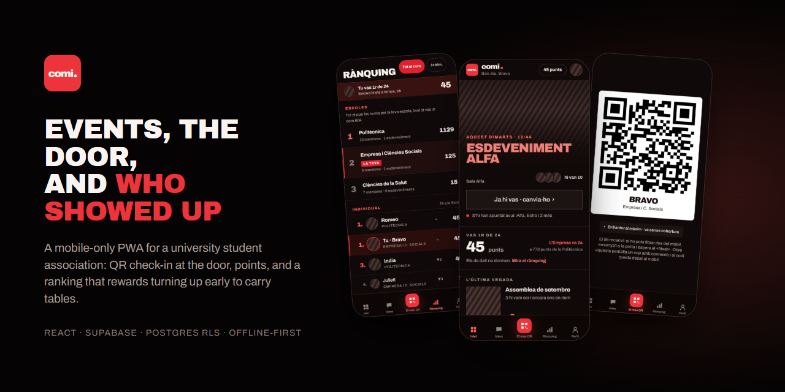
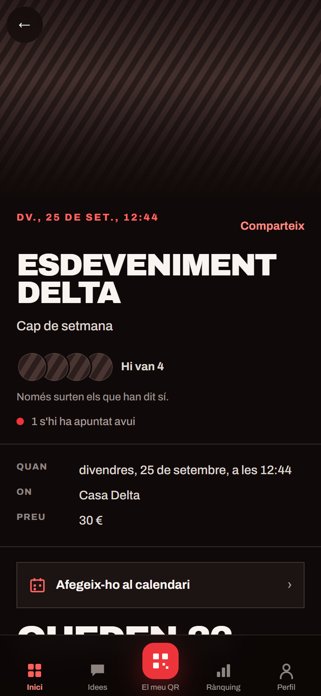
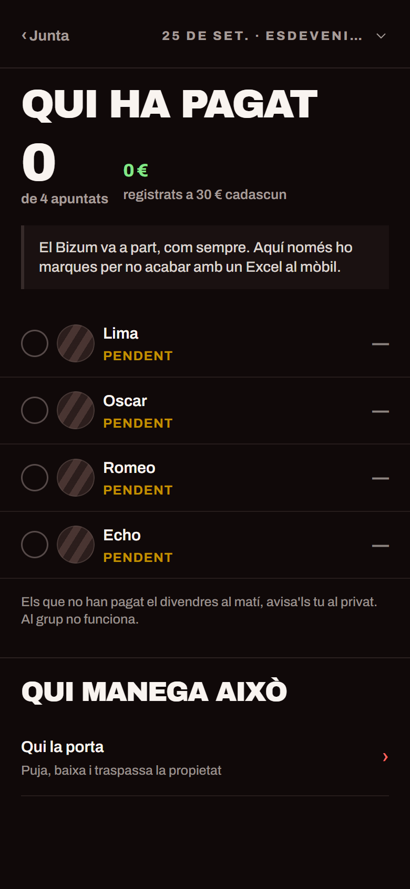
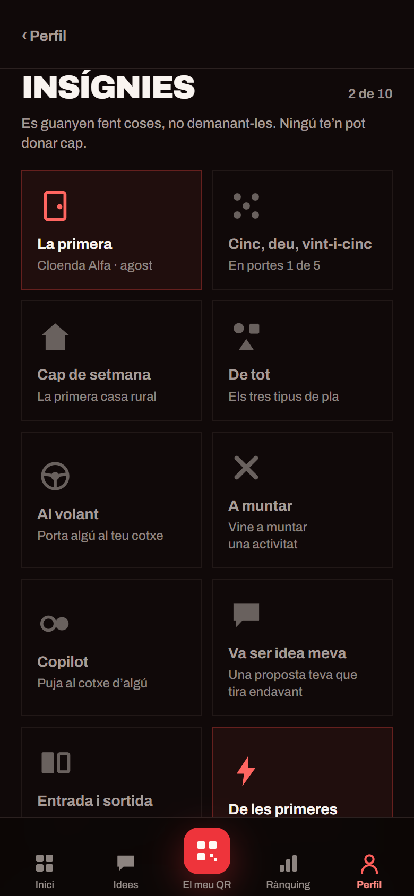
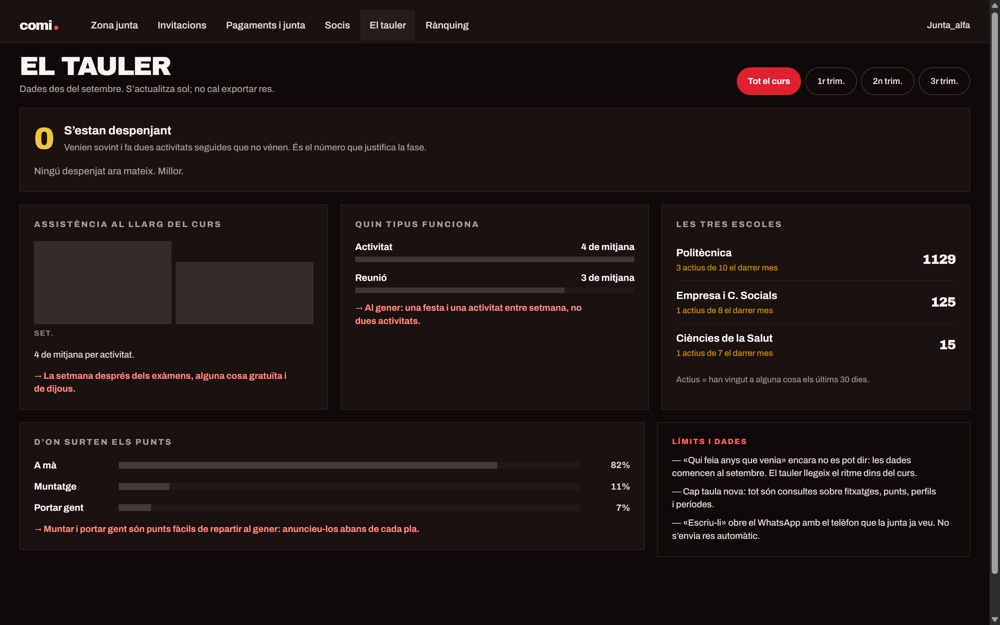

# app-comi



A mobile-only PWA for a university student association: events, QR check-in,
points and rankings. Built for the Comissió Cultural i de Festes del
TecnoCampus, and MIT-licensed so other campus associations can fork it.

The problem it exists to solve is retention in the second term. Everything in
here — the ranking by contribution rather than consumption, the public "yes"
list, the scheduled reveals — is aimed at that.

It is live at <https://comi-app.pages.dev>. Getting in needs an invitation from
the committee, so a visitor reaches the door and stops there. The screenshots
below are the local seed instead, whose members are named after the NATO
alphabet and whose addresses are `@example.test`: no real member appears in
this repository, and CI fails the build if one ever does.

## What it does

Events are published, or scheduled to reveal themselves at a time the committee
picks, with a countdown in between. Members say yes, and the yes is public,
which is most of the point. At the door somebody from the committee scans the
pass and the points land in the same transaction that marks the attendance;
or the member checks in by location, and the server decides whether they are
close enough, because a comparison that lives in the browser is a comparison
that can be rewritten.

Points come from a scale the committee edits in the app. Turning up is worth
something and carrying tables is worth more, which is the whole argument: the
ranking measures contribution, not consumption. It shows schools first and
people second, filtered by term. Badges are awarded and never taken back.
Streaks are computed on every read and never stored, so undoing a check-in
cannot leave the app quoting a number the database will not justify.

Around that: ideas members propose and vote on, car sharing where the driver is
the only person who sees a phone number, a gallery only the people who actually
came can add to, a treasure hunt whose photo proofs the committee validates one
at a time, and an arrival-and-departure diptych for each night.

The four things somebody does at a party with no signal — scan someone in,
check yourself in, submit a proof, post an idea — write to an IndexedDB queue
_before_ they touch the network, and the server functions are idempotent on an
id the client generates once. Pressing a button in a basement leaves a trace.

<table>
<tr>
<td width="25%"></td>
<td width="25%"></td>
<td width="25%"></td>
<td width="25%"></td>
</tr>
<tr>
<td>An event, with its price and the places left.</td>
<td>The door, afterwards: mark who did the work, tap the reason. Two taps.</td>
<td>Who has paid. Amber is pending, and nobody is chased in public.</td>
<td>Badges, including the ones not earned yet — a locked badge that will not
say what it wants is just a locked badge.</td>
</tr>
</table>



The dashboard is the only screen in the app that is not designed for a phone.
It is the one thing a committee does sitting down.

## Where to look, if you came to read the code

- [Security](#security) — why the anon key is public on purpose, and what
  actually holds the line instead.
- [The audit trail, and answering a subject access request](#the-audit-trail-and-answering-a-subject-access-request)
  — who did what to whom, kept for two academic years, and the query that
  answers a GDPR request the interface deliberately cannot.
- [Checking the iPhone round trip](#checking-the-iphone-round-trip) — ten
  minutes with a real phone that no laptop can replace, and what each way of
  failing looks like.
- [Handover](#handover) — the accounts the app depends on, who must own each,
  and the checklist for June when the committee changes.
- [Term dates, and moving them every year](#term-dates-and-moving-them-every-year)
  — the smallest decision in here and the one that best explains the rest.

## Stack

|          |                                                                 |
| -------- | --------------------------------------------------------------- |
| Frontend | React 19 + TypeScript + Vite 8                                  |
| Styling  | Tailwind v4 over CSS custom properties. Dark theme only         |
| PWA      | `vite-plugin-pwa` (Workbox), installable, `display: standalone` |
| Backend  | Supabase — Postgres, RLS, Auth, Edge Functions                  |
| i18n     | react-i18next — Catalan (default), Spanish, English             |
| Hosting  | Cloudflare Pages                                                |

## Getting started

Requires Node 24 (see `.nvmrc`), npm, and Docker Desktop for the local Supabase
stack.

```
npm ci
cp .env.example .env      # fill it in — see the note on hex colours inside
npm run dev
```

## Database

Migrations are versioned in this repo and applied with the Supabase CLI. The
schema is never edited through the dashboard.

```
npm run db:start          # Postgres, Auth and PostgREST in Docker
npm run db:reset          # re-applies every migration, then the seeds
npm run db:new -- nom     # a new migration file
npm run db:test           # the pgTAP policy tests
npm run test:rls          # the same policies, through PostgREST
npm run db:types          # regenerate src/lib/database.types.ts
npm run db:types:check    # fail if that file no longer matches the schema
npm run db:lint
npm run db:stop
```

**Run `npm run db:types` after any migration that changes a table, a view or a
function signature, and commit the result.** CI runs `db:types:check` against a
database built from the migrations in the commit and fails if the two disagree.
A stale types file is worse than none: it type-checks a column that no longer
exists and agrees with code that will fail at runtime.

Applying to a hosted project:

```
npx supabase link --project-ref <ref>
npm run db:push
```

`supabase/seed/` is applied by `db:start` and `db:reset` and never by
`db:push`, which is why the test helpers live there rather than in a migration.

### Term dates, and moving them every year

The chips above the ranking — the whole course, first term, second, third —
are rows in `public.ranking_periods`, not constants in the code. **The
committee changes them itself; this needs no developer and no deploy.**

The academic calendar moves every year and the committee turns over every year,
so a term boundary that needs a pull request is a boundary that stays wrong for
the whole of the term it is wrong in: the person who notices is not the person
who can change it.

In the Supabase dashboard, **Table Editor → `ranking_periods`**:

| Column      | What it is                                                                                            |
| ----------- | ----------------------------------------------------------------------------------------------------- |
| `codi`      | `curs`, `t1`, `t2`, `t3`. The app translates these four; anything else falls back to `etiqueta`.      |
| `etiqueta`  | Only for a period you invent. Leave it empty for the four above, or it will override the translation. |
| `starts_at` | When the period opens. Empty means no lower bound.                                                    |
| `ends_at`   | When it closes, **exclusive**. Empty means it never closes.                                           |
| `ordre`     | Left-to-right order of the chips. The first one is what the app opens on.                             |

The intervals are half-open, so the `ends_at` of one term should be the exact
`starts_at` of the next. That way no evening of points falls into both or
neither.

Every September, edit the four rows: move `curs.starts_at` to the first of
September, and shift `t1`, `t2` and `t3` to the new term dates. Leave
`curs.ends_at` empty so the course does not expire on a date nobody is
watching.

A point counts in the term **the event happened in**, not the term the points
were entered in — so entering the setup points for September's party in October
still files them under September.

## Signing in

Sign in with Google. There is no association domain, so there is no verified
sender and no real email can be sent — Supabase's built-in SMTP allows two
messages an hour, and the first event of the year is about a hundred sign-ups
in one evening.

**Google identifies people; it does not admit them.** Anyone with a Google
account can get as far as a profile, and that profile arrives as `pendent`.
The gate is still the invitation code, redeemed by `redeem_invite()` once
there is a session, exactly as before.

Signing in by email is still in the codebase behind `VITE_AUTH_EMAIL_FALLBACK`,
along with its templates. Set it to `true` and the email field, the magic link
and the six-digit code all come back alongside the Google button. It is off
because it cannot deliver, not because it was removed.

### Checking the iPhone round trip

**Do this on a real iPhone before the first event.** Ten minutes, and anyone on
the committee can do it. It is the one thing about this app that cannot be
verified from a laptop, and if it fails the consequence is not a small one.

Why it matters: a web app added to the iPhone home screen gets its own storage,
separate from Safari. A session created on one side does not exist on the
other. The old magic link fell into exactly that hole — the link was tapped in
Mail, which has no way to hand back to a home-screen icon, so it opened Safari
and the installed app stayed signed out. That is why the email carried a
six-digit code.

Google should not have the same problem, for a structural reason: the app
itself navigates away, and Google redirects back to our own origin, which is
inside the app's manifest scope. Since iOS 12.2 an out-of-scope navigation from
an installed app opens in an in-app browser, and a redirect back _into_ scope
returns control to the app. The PKCE verifier stays in the context that started
the trip, which is the same one that receives the code.

That was the theory, and it holds: it has been run on a real iPhone against the
deployed app — installed from the icon, Safari closed completely — and it comes
back inside the app with a session.

Keep running it anyway. It depends on iOS behaviour that Apple has changed
before and on the Google client being configured correctly for whichever
origin you are testing, so it is worth ten minutes at the start of each year
and after any change to the redirect URLs.

**The test**

1. On an iPhone, in Safari, open the app and add it to the home screen.
2. Close Safari completely. Open the app **from the icon**.
3. Tap _Entra amb Google_ and complete the Google sign-in.
4. Watch where you end up.

**Pass:** you land back inside the app, full screen, with no Safari address bar,
and you are signed in.

**Fail, and what each looks like:**

| What you see                                                                                   | What it means                                                                                     |
| ---------------------------------------------------------------------------------------------- | ------------------------------------------------------------------------------------------------- |
| You end up in Safari with an address bar, signed in there, and the icon is still signed out    | iOS sent the round trip to Safari instead of the in-app browser. This is the one that matters.    |
| The app reopens showing _"Sembla que has entrat però la sessió s'ha quedat al navegador"_      | The same thing, caught by the app. That message only ever appears in this case.                   |
| Google shows an error about a disallowed browser or user agent                                 | Google is refusing the in-app browser as an embedded webview.                                     |
| Everything works, but it asks for your Google password even though you are signed in elsewhere | Not a failure. The in-app browser does not share Safari's cookies. Mildly annoying, nothing more. |

**If it fails.** The installed app cannot sign anybody in, which makes promoting
installation on iOS actively harmful. Two things to do, in this order:

1. Set `VITE_AUTH_EMAIL_FALLBACK=true` and redeploy. The email path with the
   six-digit code comes back and works from the icon, because a typed code does
   not care which storage jar it is typed into. It will hit the SMTP rate limit
   at scale, so pair it with a real SMTP provider or a bought domain.
2. Until that is sorted, stop showing the install screen on iOS — a signed-out
   icon is worse than a browser tab.

Report the result either way: an issue on the repo, or a note wherever the
committee keeps decisions. The next person to wonder should not have to test it
again.

## Deploying

Do these in order. The Cloudflare URL does not exist until the first build, and
Supabase needs it afterwards, so anything that depends on it comes last.

Throughout, `<ref>` is the Supabase project ref (the subdomain of the project
URL) and `<project>` is the Cloudflare Pages project name.

### 1. Supabase — enable pg_cron, before anything else

Dashboard → Database → Extensions → search `pg_cron` → enable.

Do this first. The retention migration needs it, and creating the extension
from a migration on a hosted project is known to leave the schema grants
half-set even when the dashboard reports it active. Enabling it here makes the
migration a no-op instead.

While you are there, enable `pg_net` too, for the same reason. Migration 47
needs it to send the reveal notification, and it raises `0A000` with
instructions rather than applying half-done if it is missing.

### 2. Supabase — push the schema

```
npx supabase link --project-ref <ref>
npm run db:push
```

**Do not run `supabase config push`.** It exists, and the CLI help makes it look
like the right thing to do, but `supabase/config.toml` is tuned for local
development: it would set the project's Site URL to `http://127.0.0.1:5173` and
overwrite the Google credentials with the local test client. Auth settings are
done in the dashboard, in the steps below.

`db push` sends migrations and nothing else — not seeds, not auth config, not
the email templates.

**There are two projects, and the staging one is kept level with production.**
Every migration goes to staging first, gets looked at there, and only then goes
to production. That order is the whole point of having it: a migration that
passes locally against seed data has not met a real project's auth schema,
extensions or data.

Staging is only useful if it is _actually_ level. It fell four migrations
behind once, which meant the four rehearsals that mattered most — the ones
fixing defects production had already shown — were rehearsed nowhere. So:

```
# staging first, always
npx supabase link --project-ref <staging-ref> && npm run db:push
# look at it, then
npx supabase link --project-ref <production-ref> && npm run db:push
```

And take a backup before each round; the exact commands are in the "Backups"
section below.

### 3. Google Cloud — the production OAuth client

APIs & Services → Credentials → Create credentials → OAuth client ID → Web
application.

**Authorized redirect URI** — exactly one, and it is Supabase's callback, not
the app's address:

```
https://<ref>.supabase.co/auth/v1/callback
```

Leave **Authorized JavaScript origins** empty. The app never talks to Google
directly; Supabase does the exchange.

On the OAuth consent screen, the application name is what people see on the
Google page as _"Continue to …"_. Put the association's name there.

### 4. Supabase — turn Google on

Authentication → Providers → Google → enable, and paste the client ID and
secret from the previous step.

### 5. Cloudflare Pages — connect and build

Workers & Pages → Create → Pages → Connect to Git → pick the repository.

| Setting                | Value           |
| ---------------------- | --------------- |
| Framework preset       | None            |
| Build command          | `npm run build` |
| Build output directory | `dist`          |
| Root directory         | `/`             |

Environment variables, for **both** Production and Preview:

| Variable                 | Value                                     |
| ------------------------ | ----------------------------------------- |
| `NODE_VERSION`           | `24`                                      |
| `VITE_APP_NAME`          | the association's full name               |
| `VITE_APP_SHORT_NAME`    | the short one, what shows under the icon  |
| `VITE_APP_DESCRIPTION`   | one line                                  |
| `VITE_APP_TAGLINE`       | shown under the wordmark on the door      |
| `VITE_THEME_COLOR`       | `#100909`                                 |
| `VITE_BACKGROUND_COLOR`  | `#100909`                                 |
| `VITE_DEFAULT_LOCALE`    | `ca`                                      |
| `VITE_TIME_ZONE`         | `Europe/Madrid`                           |
| `VITE_SUPABASE_URL`      | `https://<ref>.supabase.co`               |
| `VITE_SUPABASE_ANON_KEY` | the project's anon key — public by design |
| `VITE_WHATSAPP_URL`      | the group invite link                     |
| `VITE_SITE_URL`          | `https://<project>.pages.dev`, no slash   |

`VITE_SITE_URL` only feeds the link-preview image (`og:image` must be an
absolute URL); empty, the build works and the preview loses its picture. The
image itself is `public/og-image.png`, drawn from the app icon by
`node scripts/make-og-image.mjs` — rerun it after replacing the icons.

Paste the hex colours plain, with no quotes. The quoting rule in
`.env.example` is a dotenv quirk and does not apply here.

Forget one of `VITE_APP_NAME`, `VITE_APP_SHORT_NAME`, `VITE_SUPABASE_URL` or
`VITE_SUPABASE_ANON_KEY` and the build stops with a message naming exactly
which. That is deliberate: the alternative is a deploy that succeeds and shows
`%VITE_APP_NAME%` in the title bar.

`public/_headers` and `public/_redirects` are copied into `dist` and picked up
automatically. They stop the HTTP cache holding a stale `index.html` or `sw.js`,
which is what would otherwise show pre-reveal content after a reveal.

Deploy. Note the URL: `https://<project>.pages.dev`.

### 6. Supabase — point auth at the real address

Authentication → URL Configuration.

**Site URL**

```
https://<project>.pages.dev
```

**Redirect URLs** — the second line covers preview deploys, which get a
different hostname on every pull request:

```
https://<project>.pages.dev/**
https://*.<project>.pages.dev/**
```

No rebuild is needed after this. The app derives its redirect from
`window.location.origin` at run time, so it follows whatever address it is
served from.

### 7. GitHub — the keepalive URLs and keys

Settings → Secrets and variables → Actions. The URLs go under **Variables**,
the anon keys under **Secrets**:

| Name                        | Kind     | Value                                   |
| --------------------------- | -------- | --------------------------------------- |
| `SUPABASE_URL`              | Variable | production, `https://<ref>.supabase.co` |
| `SUPABASE_ANON_KEY`         | Secret   | production's anon key                   |
| `STAGING_SUPABASE_URL`      | Variable | Staging, `https://<ref>.supabase.co`    |
| `STAGING_SUPABASE_ANON_KEY` | Secret   | Staging's anon key                      |

Free-tier projects pause after a week without activity, and over the summer
that will happen. The workflow runs every day and reads one row from each
project, production and Staging separately, so one being down does not skip
the other and the run turns red showing which. An empty variable or secret
fails the job with a message naming it. A Variable and a Secret with the same
name are different things, so a key saved in the wrong tab reads as empty.

To check it, run `gh workflow run keepalive.yml` (it only works once the file
is on `main`) and open the run: both `ping (production)` and `ping (staging)`
must be green and print `production: HTTP 200` / `staging: HTTP 200`.

Note that GitHub also disables scheduled workflows in a public repository
after 60 days with no commits, and emails the owner — so the thing keeping the
database awake falls asleep first if work stops. Treat that email as an action
item.

### 8. Supabase — make the first person the owner

Sign in through the app with Google first, so the profile row exists. Then, in
the SQL editor:

```sql
-- Once, for the first person. Everything after this happens in the app.
update public.profiles
   set estat = 'actiu',
       role  = 'owner'
 where id = (select id from auth.users where email = 'you@example.com');
```

This is the one thing that cannot be done from the app, and that is deliberate.
`admin_set_member_role` refuses anybody who is not already an admin, and the
`owner` role on top of that refuses anybody who is not already an owner — so
with an empty table there is no first move. The SQL editor has one because it
runs as `postgres`, and the trigger that protects `role` and `estat` only fires
for `authenticated`.

Make the first account `owner` and not `admin`. Only an owner can grant the
owner role, so an installation whose first account is merely an admin can never
have one. From here on nothing else needs the editor: an owner or an admin
names the rest of the junta from _Pagaments i junta_, and every one of those
changes lands in `audit_log`. This first one does not — it happened outside the
function that writes the trail, which is worth knowing when you read it back.

If somebody signs in and sees "encara ets a la llista d'espera", that is the
same table: they are `pendent` until the junta approves them from
_Invitacions_. A pending member can look around but cannot sign up for anything
and has no QR, because the door would turn them away.

### 9. Supabase — the reveal notification (optional)

The app works without this. «Avisa'm» records the interest either way, and
whoever pressed it finds the event at the top of their home screen the first
time they open the app after the reveal — that is the promise, and it needs no
notification. What this step adds is the phone buzzing on the day.

It is also a **departure from the spec**: section 13 of
`02-especificacion-tecnica.md` says no push in v1, and the reason it gives is
still true — on iOS a PWA only receives notifications if the person has added
it to their home screen. Migration 47 says so in its header.

Generate a key pair. The public half ships in the bundle; the private half
signs, and must never be in this repo:

```
npx web-push generate-vapid-keys
```

Then, in three places:

1. **Cloudflare Pages** → the build environment → `VITE_VAPID_PUBLIC_KEY` =
   the public key. Without it the app never asks for the permission, which is
   the correct behaviour for an installation that has not set this up.

2. **Deploy the function**, which is also what makes it appear in the
   dashboard at all — before this there is nothing under Edge Functions to
   click on:

   ```
   npx supabase functions deploy reveal-push
   ```

3. **The secrets.** They belong to the **project**, not to one function:
   Supabase → Project Settings → Edge Functions → Secrets, or from here with
   `npx supabase secrets set NAME=value`. Every function sees all of them, so
   there is no per-function panel to look for.

   | Name                | Value                                    |
   | ------------------- | ---------------------------------------- |
   | `VAPID_PUBLIC_KEY`  | the public key                           |
   | `VAPID_PRIVATE_KEY` | the private key                          |
   | `VAPID_SUBJECT`     | `mailto:` and an address the junta reads |
   | `REVEAL_PUSH_TOKEN` | a long random string you invent          |
   | `APP_ORIGIN`        | the site's address, no trailing slash    |

   `SUPABASE_URL` and `SUPABASE_ANON_KEY` are not in that list because the
   runtime injects them, and `reveal-push` uses neither: it holds no database
   credential at all.

4. **Supabase → SQL editor**, so the cron can reach the function. Leave this
   for last: it is what arms the job. The same token, and the function's URL:

   ```sql
   select vault.create_secret('<REVEAL_PUSH_TOKEN>', 'reveal_push_token');
   select vault.create_secret(
     'https://<ref>.supabase.co/functions/v1/reveal-push', 'reveal_push_url');
   ```

Why a shared token and not the anon key: the anon key is public — it ships in
the browser bundle — so `verify_jwt` cannot tell our cron from a stranger.
`reveal-push` is the only function in the project with `verify_jwt = false`,
and the token in its first lines is what replaces it. What it can do if
somebody gets past that door is limited by design: it holds no database
credential at all and only knows how to encrypt and post whatever arrives in
the request body. The database decides who gets told and what it says.

Until the two `vault` secrets exist, the cron logs a warning every minute and
sends nothing. That is deliberate — a scheduled job failing silently is worse
than one that is not there.

### 10. Test it on an iPhone

See _Checking the iPhone round trip_ above. Do it before the first event, not
after.

### If you ever turn the email fallback back on

`VITE_AUTH_EMAIL_FALLBACK=true` is only half of it. The email templates in
`supabase/templates/` are wired up in `config.toml`, which is local-only, so
they have to be pasted into Authentication → Emails in the dashboard as well.
Otherwise the association's first contact with a new member is Supabase's
English default. Turn _Confirm email_ off there too, so the sign-in link is the
confirmation rather than a second step.

## Security

**The anon key is public by design.** It ships in the JavaScript bundle and is
visible in devtools. Row Level Security is the only boundary, so every table
has policies and every policy has a test.

**The `service_role` key is not in this repo**, not in `.env.example`, not
commented out, and never in the frontend. It bypasses every policy in
`supabase/`. It lives as a Supabase Functions secret, and the platform injects
it into Edge Functions automatically — `reveal-push`, the only Edge Function
this project has, deliberately does not use it at all: it has no Supabase
client, and all it can do is encrypt and send whatever the cron hands it.

Two test layers, because each is blind to the other's failures:

- **pgTAP** (`supabase/tests/`) asserts what has no HTTP signature: RLS
  actually enabled, views that are `security_invoker`, definer functions with a
  pinned `search_path`, the partial unique index the check-in depends on.
- **Vitest through PostgREST** (`tests/rls/`) asserts what has no SQL
  signature: resource embedding, the filtered `count=exact`, the status codes
  the UI branches on, and the real GoTrue signup path.

Two things worth knowing before writing a query:

- `profiles` is ordinary: `select('*')` works and carries nothing sensitive.
  The check-in credential lives in `profile_secret` (own row only, and not
  readable by admins either) and the phone number in `profile_contact` (own row
  plus the junta). They are separate tables rather than revoked columns
  because a revoke made `*` fail, and a guarantee that surfaces as a
  permission error on an ordinary query is one somebody eventually removes.
- Scheduled content is filtered with Postgres `now()`. An `if` in React is not
  hiding anything — the response is in the network tab either way.

### The audit trail, and answering a subject access request

`audit_log` records role changes, membership approvals and payment marks — who
did what to whom. It exists because the committee turns over every year and
"who made them an admin?" is otherwise unanswerable six months later.

**Kept for 24 months, then deleted.** Two academic years: long enough for the
outgoing committee and the next one to be asked about a decision, short enough
that it is not a permanent record. A `pg_cron` job runs
`private.purge_audit_log()` nightly at 04:30. Nobody can run it by hand — not
even an admin — because a trail the people in it can clear is not a trail.

**A member does not see their own rows in the app.** That is deliberate: the
trail records what the committee did, and showing somebody a partial view of
it would mislead more than showing none.

**That is a product decision, not a legal one.** If someone exercises their
right of access under GDPR, the association has to hand over what it holds
about them, whether or not the interface shows it. Nobody can do that from the
app, so here is how.

An owner runs this in the Supabase SQL editor. Replace the uuid on the first
line with the person's profile id — plain SQL, no psql meta-commands, because
the SQL editor does not support them.

```sql
-- Everything the association holds about one person.
-- Run as the project owner. Give them the output, not the query.
with subject as (select '00000000-0000-0000-0000-000000000000'::uuid as id)
select 'perfil' as font, to_jsonb(p) as dades
  from public.profiles p, subject s where p.id = s.id
union all
select 'contacte', to_jsonb(c)
  from public.profile_contact c, subject s where c.id = s.id
union all
select 'inscripcions', to_jsonb(a)
  from public.attendances a, subject s where a.user_id = s.id
union all
select 'punts', to_jsonb(l)
  from public.points_log l, subject s where l.user_id = s.id
union all
select 'propostes', to_jsonb(pr)
  from public.proposals pr, subject s where pr.user_id = s.id
union all
select 'vots', to_jsonb(v)
  from public.proposal_votes v, subject s where v.user_id = s.id
union all
select 'invitacio_usada', to_jsonb(iu)
  from public.invite_uses iu, subject s where iu.user_id = s.id
union all
select 'dades_viatger', to_jsonb(v)
  from public.dades_viatger v, subject s where v.user_id = s.id
union all
-- Who on the committee opened their traveller details. Those rows name the
-- event as target and list the people in `detall`, so `target_id` misses them.
select 'consultes_dades_viatger', to_jsonb(al)
  from public.audit_log al, subject s
 where al.accio = 'consulta_viatgers' and al.detall->'persones' ? s.id::text
union all
-- Both directions: rows about them, and rows recording what they did while on
-- the committee. Somebody asking what is held about them is owed both.
select 'registre_sobre_ell', to_jsonb(al)
  from public.audit_log al, subject s where al.target_id = s.id
union all
select 'registre_fet_per_ell', to_jsonb(al)
  from public.audit_log al, subject s where al.actor_id = s.id;
```

`profile_secret` is deliberately absent. It holds one QR token, which is a
credential rather than information about the person; hand it over and anybody
holding the export can be checked in as them. If they ask specifically, rotate
it first.

**Still to do before launch:** the GDPR notice has to name traceability as a
purpose for processing, alongside the obvious ones. It is a legitimate purpose
and a short paragraph, but it has to be written down before the first sign-up,
not after.

## Backups

**There is no PITR and there are no managed backups**: this is a free-tier
project. There is also no nightly job, deliberately — it would need a
`service_role` key living as a GitHub Actions secret, and that is a credential
that bypasses every policy in `supabase/` sitting in one more place. Whether
that trade should change is open: see "Monthly checklist" below.

So the policy is manual and it is a habit: **a full backup before every round
of migrations**, downloaded locally, kept outside this repository. A full
backup is three SQL files and the bucket files.

### The database

```
npx supabase db dump --linked -s public,private,auth -f <somewhere>/<date>-schema.sql
npx supabase db dump --linked --data-only -s public,private,auth -f <somewhere>/<date>-data.sql
npx supabase db dump --linked --role-only -f <somewhere>/<date>-roles.sql
```

**`auth` is not optional.** `public.profiles.id` references `auth.users(id)`, so
a `public`-only dump does not restore: every profile row fails its foreign key
on the way in, and the rest cascades off that.

**`private` is not optional either**, and it is the one that is easy to
forget because nothing in the app lists it. `private.event_geo` holds the
coordinates of every event: PostgREST does not expose that schema, so no
screen would show you they are missing. Restore without it and every event
silently stops accepting check-in by location. The data dump carries it only
because `private` is in the `-s` list.

Do not add `storage` to that list. It would bring the rows of
`storage.objects` — names, sizes, metadata — and none of the bytes, and those
rows would collide with the buckets the migrations already create. The files
are copied separately, below, and uploading them is what recreates the rows.

The data file starts with `set session_replication_role = replica`, so
triggers and foreign keys do not fire while it loads. That is what lets it
load in table order without an audit row for every insert.

Check the dump rather than trusting it: `grep -c 'private"."event_geo"'` on the
data file, and count the tuples of `profiles` and `events` against the project.

### The bucket files

Five buckets, from `supabase/config.toml` and the storage migrations:
`event-covers`, `door-photos`, `event-photos`, `gimcana-photos`, `avatars`.
All are private. The CLI copies one path at a time, so one recursive copy per
bucket:

```
for b in event-covers door-photos event-photos gimcana-photos avatars; do
  npx supabase storage cp -r --linked "ss:///$b" "<somewhere>/<date>-storage/$b"
done
```

`npx supabase storage ls -r --linked ss:///<bucket>` lists a bucket, which is
how to compare file counts afterwards. If a bucket is added in a migration,
add it to that loop; `grep -rn "storage.buckets" supabase/migrations` finds
them.

### What a dump does not carry

The Vault, where `reveal_push_url` and `reveal_push_token` live. Restore into a
fresh project and the reveal notifications stop going out, silently, until
somebody puts both secrets back by hand (section 9 above).

The `pg_cron` jobs: `purge-audit-log`, `send-reveal-pushes` and
`purga-avis-pendents`. They live in the `cron` schema, which is not in the
dump. The migrations that create them (10, 47 and 87) re-run them; a
restore that skips the migrations has no jobs and nothing says so.

### Restoring

Order matters.

1. A new project, with `pg_cron` and `pg_net` enabled first (deploy step 1).
2. Roles: `psql … -f <date>-roles.sql`. One line may fail on a role that only
   the managed platform has (`supabase_realtime_admin`); the `ALTER ROLE`
   lines before it are the ones that matter.
3. Schema: `<date>-schema.sql`, then data: `<date>-data.sql`. Use
   `supabase_admin` locally; on a hosted project the `postgres` role is what
   you have. A hosted project already has its own `auth` tables at the
   current version, so expect a block of "already exists" and "multiple
   primary keys" errors from the `auth` part of the schema file. They are
   noise; anything about `public` or `private` is not.
4. The bucket files, bucket by bucket, the other way round:
   `npx supabase storage cp -r --linked "<somewhere>/<date>-storage/<bucket>" "ss:///<bucket>"`.
5. The Vault secrets and the three cron jobs, if the migrations did not run.
6. Check: row counts of `profiles`, `events` and `auth.users`, that
   `private.event_geo` is populated, `select jobname from cron.job`, and one
   cover photo that actually opens in the app.

What was rehearsed in local, from a dump of the shared development database
into an empty database in a throwaway container of the same Postgres image:
the schema file loaded with zero errors, the data file with zero errors, and
the counts matched (59 profiles, 12 events, 59 users and 59 identities). A
dump taken from that restored database brought `private.event_geo` back with
a row in it, and the same dump without `private` in `-s` did not. What is
**not** proven: the bucket copy (the CLI call was checked against `--help`,
not run), a restore into a real hosted project, and the Vault and cron steps
beyond creating a secret and a job by hand.

### Monthly checklist

- Dump the three SQL files above and the five buckets.
- Count `private.event_geo` and `storage.objects` in the dump against the
  project.
- Open the newest dump in a text editor and check it is not empty.
- Keep the last three; delete older ones.
- Once a term, restore the newest into the Staging project and open the app.

Automating this is undecided: either a private repository in the organisation
with an `age`-encrypted dump taken by a read-only role, or this checklist done
by hand each month. Tracked in
[#24](https://github.com/Comissio-Cultural-i-de-Festes/app/issues/24); until it
is decided the checklist is the policy.

## Handover

The committee turns over every year, and the app outlives every committee. This
section is what the incoming one needs to take it over without calling anybody:
what exists, who must own it, and what to do in June. It does not repeat how
things work; it points at the section that does.

### Accounts and services

Owners are **roles, not people**. A credential that belongs to a person leaves
with them; one that belongs to "the treasurer" or "the secretary" is passed on
with the post. Every credential below also has a copy in the committee's shared
password manager, which is the one place nobody has to ask a predecessor for.

| Service                            | What it is                                                                                                                                                            | Owner (role)                            | Where the credential lives                                                           | If it is lost                                                                                                                                                  |
| ---------------------------------- | --------------------------------------------------------------------------------------------------------------------------------------------------------------------- | --------------------------------------- | ------------------------------------------------------------------------------------ | -------------------------------------------------------------------------------------------------------------------------------------------------------------- |
| GitHub organisation                | The code, CI, and the daily keepalive ([step 7](#7-github--the-keepalive-urls-and-keys)). Two-factor authentication must be required of every member ([#33][i33]).    | Two or more organisation owners, always | Each person's own account, with 2FA; recovery codes in the shared manager            | With a single owner gone, nobody can add the next one and the repository is frozen. That is why there are two.                                                 |
| Supabase, production and Staging   | The database, auth, storage and the Edge Function. Two projects, each with its own `<project-ref>`. Everything else depends on these.                                 | The technology role                     | The account's login; the database passwords and both anon keys in the shared manager | Nobody can push a migration, take a backup or read the logs. Support can recover an account only if the sign-up address still receives mail.                   |
| Google Cloud                       | The OAuth client behind _Entra amb Google_ ([step 3](#3-google-cloud--the-production-oauth-client)). The consent screen must read **In production** ([#32][i32]).     | The same role as Supabase               | The Google account that owns the project; client ID and secret in the shared manager | Nobody can sign in. If the screen says _Testing_, only accounts added by hand can enter and nothing says why.                                                  |
| Cloudflare Pages                   | Hosting and the build. Holds every `VITE_*` variable of `.env.example` (`VITE_APP_NAME`, `VITE_SUPABASE_URL`, `VITE_SITE_URL`, `VITE_VAPID_PUBLIC_KEY` and the rest). | The same role as Supabase               | The account's login; a copy of the variables list in the shared manager              | The site cannot be rebuilt. The live one keeps working until the next deploy. The values are public, but nobody remembers all of them.                         |
| VAPID keys and `REVEAL_PUSH_TOKEN` | The private key that signs the reveal notifications, and the token the cron presents to `reveal-push` ([step 9](#9-supabase--the-reveal-notification-optional)).      | The same role as Supabase               | Supabase secrets **and** the shared manager. The private half is nowhere else.       | Not recoverable. A new pair can be generated, but every subscription made with the old public key stops working and members have to allow notifications again. |
| WhatsApp group                     | Where the committee reaches members, and where `VITE_WHATSAPP_URL` points: "ask for an invitation there".                                                             | The president or the secretary          | The admin role inside the group; the invite link in the shared manager               | The invite link on the door screen stops working, so people who need an invitation have nowhere to ask. A new link means changing `VITE_WHATSAPP_URL`.         |

[i32]: https://github.com/Comissio-Cultural-i-de-Festes/app/issues/32
[i33]: https://github.com/Comissio-Cultural-i-de-Festes/app/issues/33

Two of those are open checks rather than facts, and the first June is when to
close them:

- **Google Cloud belongs to the association and not to a person.** Open the
  project in the console and see whose it is, then _Google Auth Platform →
  Audience_ and check the publishing status. With only the basic scopes that
  sign-in asks for, _In production_ costs nothing and needs no verification
  ([#32][i32]).
- **The private VAPID key and `REVEAL_PUSH_TOKEN` are in the shared manager.**
  Supabase shows that a secret exists but never what it says, so the only copy
  that can be read is the one somebody saved ([#32][i32]).

### The June handover

Do this when the new junta takes over, ideally together with the old one and
before the summer. Over July and August nobody is watching, which is exactly
when a paused project or a disabled workflow goes unnoticed.

1. **Roles in the app.** The outgoing owner hands ownership over from
   _Pagaments i junta_, under _Hand over ownership_ (`admin_transfer_owner`).
   It takes two steps, there is always exactly one owner, and the old one
   becomes an admin. Then the new owner names the rest of the junta and
   demotes whoever left. Read the result back in the audit trail on the same
   screen. If the owner's Google account is gone before they hand it over,
   somebody has to fix it in the database: see
   [step 8](#8-supabase--make-the-first-person-the-owner).
2. **People who are leaving the association.** The junta sets their status to
   `baixa` in the app rather than deleting them: they stop having access and their
   points and attendances stay in the history of the course. What to do with
   their data is the last item below.
3. **The new course.** Edit the four rows of `ranking_periods`, as in
   [Term dates, and moving them every year](#term-dates-and-moving-them-every-year).
   Do it in June for the dates already known and again in September for the
   rest: a ranking with last year's boundaries is wrong on the first evening.
4. **The accounts above.** Add the new people to the GitHub organisation (and
   check it still requires 2FA), Supabase, Google Cloud and Cloudflare, and
   only then remove the old ones. Remove people from the shared manager too, or
   rotate what they could read. A departed member who still has the database
   password or the `service_role` key is the one real risk in here.
5. **The iPhone round trip.** Run
   [Checking the iPhone round trip](#checking-the-iphone-round-trip) on a real
   phone. Apple changes this behaviour without notice, and nothing else tells
   you.
6. **The keepalive.** Open Actions → _keepalive_ and check the last run: both
   `ping (production)` and `ping (staging)` green. The four names
   (`SUPABASE_URL`, `SUPABASE_ANON_KEY`, `STAGING_SUPABASE_URL`,
   `STAGING_SUPABASE_ANON_KEY`) are in
   [step 7](#7-github--the-keepalive-urls-and-keys). Then look at the date of the
   last commit: GitHub switches scheduled workflows off after 60 days without
   one, and the only warning is an email to the owner, so the new owner must
   be on an address that is read. If it is off, make a commit or re-enable it
   from the Actions tab.
7. **A backup, and a restore.** Take the full backup in [Backups](#backups) and
   keep it outside the repository. Once a year at least, restore it into
   Staging and open the app; a backup nobody has restored is a hope. The
   monthly checklist in that section is the policy in between.
8. **Secrets.** Check the shared manager against the table above: the database
   passwords, the Google client secret, the VAPID private key and
   `REVEAL_PUSH_TOKEN` are all there and still open. Rotate whatever a leaving
   person could read. Rotating `REVEAL_PUSH_TOKEN` means changing it in the
   Supabase secrets **and** in the Vault entry `reveal_push_token`
   ([step 9](#9-supabase--the-reveal-notification-optional)), or the cron is
   turned away at the door and says so only in the logs.
9. **Storage.** In Supabase → Storage look at the five buckets listed in
   [The bucket files](#the-bucket-files). `gimcana-photos` grows fastest, one
   photo per proof, and nothing deletes them: once the year's treasure hunt is
   over and its results are final, download them into the backup and clear the
   bucket.
10. **Free-plan limits.** In each Supabase project's usage page, check
    database size, storage, egress and monthly active users against the
    current free-plan limits (they change, so the provider's pricing page is
    the source, not this README). A project past its ceiling starts refusing
    work in the middle of an event, which is the worst moment. Cloudflare
    Pages also has a monthly build limit, which matters in a month with many
    pull requests.
11. **Last year's personal data.** The audit trail deletes itself after 24
    months
    ([The audit trail](#the-audit-trail-and-answering-a-subject-access-request))
    and pending notices have their own nightly purge. Nothing else expires:
    profiles, contacts, points and attendances stay for as long as the
    database does. Decide as a committee how long that is, write it in the
    privacy policy, and if it is shorter than forever, delete the rows of the
    `baixa` members from item 2 once the period is up. Record the decision
    where the committee keeps decisions.

Where the committee keeps its decisions, and where the shared password manager
lives, are not things a public repository should say. Write both on the first
page of whatever the committee hands to the next one, and check in June that
the new people can open them.

## Brand colours

There are two reds and they are not interchangeable.

|                  | Value                                 | Used for                                                  |
| ---------------- | ------------------------------------- | --------------------------------------------------------- |
| Logo red         | `#991B16` · `oklch(0.443 0.162 28.4)` | The logo, the favicon, print. **Never in the interface.** |
| `--ds-brand`     | `oklch(0.62 0.22 25)`                 | The on-screen identity: fills, accents, selection         |
| `--ds-brand-cta` | `oklch(0.58 0.22 25)`                 | Filled buttons only — see the note in `tokens.css`        |
| `--ds-error`     | `oklch(0.74 0.19 48)`                 | Errors. Never either of the reds above                    |

The logo red is too dark to sit under text on a dark background, which is why
the screen version is lighter. State colours never use the brand hue: the
scanner has to be readable in half a second, at night, and if red meant both
"us" and "rejected" it would not be.

## Forking this for another association

Three places, and nothing else is association-specific:

1. `src/styles/tokens.css` → the `BRAND` block. Seven colours and a shadow. If
   your colour is not red, also replace hue `25` in the `SURFACES` block, since
   the neutrals are tinted with the brand hue.
2. `public/` → the five icon files.
3. `.env` → name, short name, description, theme colour.

## Conventions

- **Conventional Commits**, in Catalan: `type(scope): lowercase imperative`.
  Types: `feat` `fix` `chore` `docs` `refactor` `test` `style`. One commit per
  logical change. No co-author trailers, no generated-with footers.
- **No extra markdown files.** This README and genuinely necessary docs only.
- Every user-facing string goes through i18next from the first commit.
  `npm test` fails if a key exists in `ca.json` and is missing from `es.json`
  or `en.json`.
- **Copy belongs to the committee, not to whoever wrote the code**, and it
  lives in two places, not one:
  - `src/i18n/locales/*.json` — everything on screen.
  - `supabase/templates/*.html` plus their subjects in `supabase/config.toml`
    — the sign-in emails. Easy to forget, because nobody on the team sees them
    once sign-in works. Both carry a link _and_ a six-digit code, and the code
    is not optional: see the note in `magic_link.html`.

  Informal Catalan for actions and empty states; plain and unfunny for errors,
  money, the door and anything legal.

- Colours live only in `src/styles/tokens.css`, and no state colour may use the
  brand hue. Both are tested.
- Fixtures are obviously synthetic — NATO alphabet handles, `@example.test`
  addresses, invented school and venue names. CI greps for real-world
  identifiers, because the association is small enough that a realistic
  Catalan name identifies someone even when it was invented.
- Run `npm run check` before opening a pull request.

## Licence

MIT — see `LICENSE`. The association's name and logo are its own and are not
covered by it.
